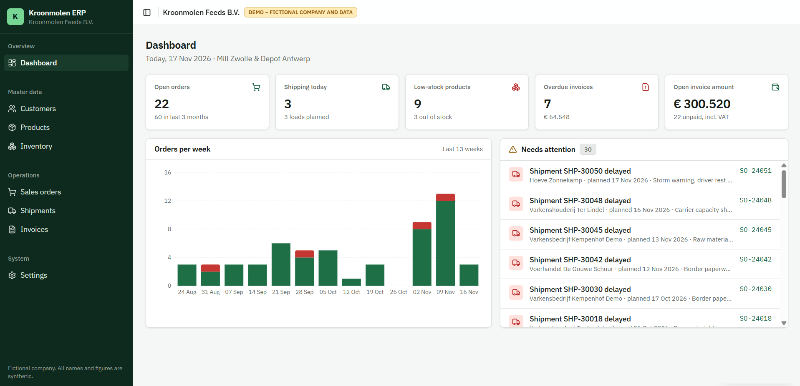
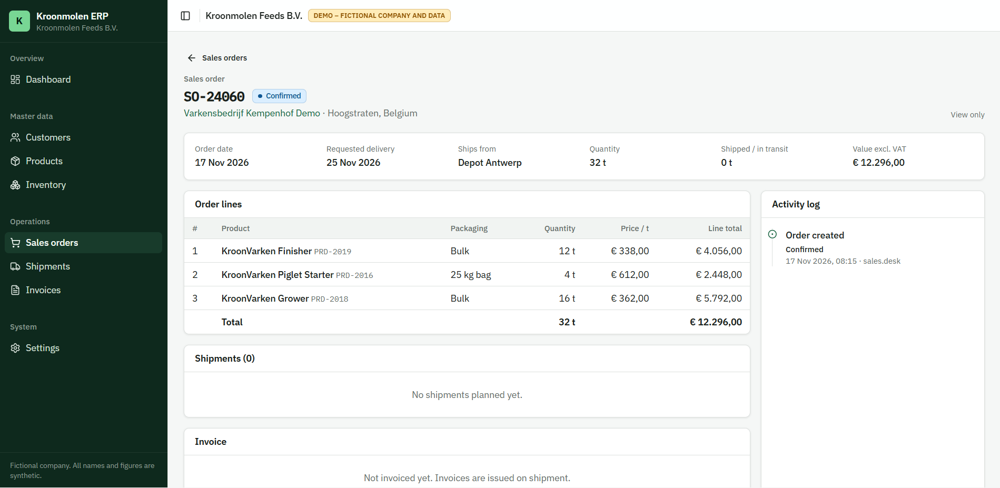
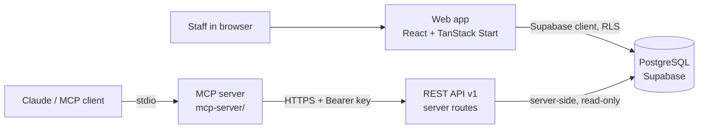
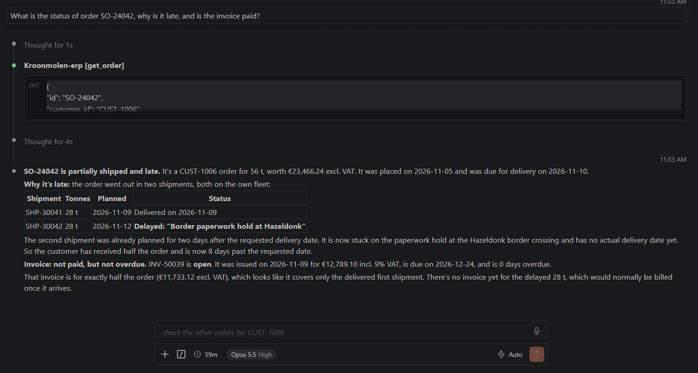
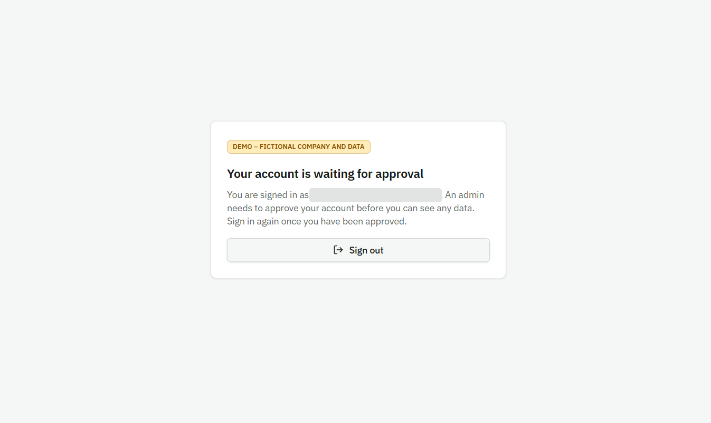

# Kroonmolen ERP

Back-office ERP for **Kroonmolen Feeds B.V.**, a fictional Dutch compound-feed producer that sells bagged and bulk feed to farms and dealers in the Netherlands and Belgium. Besides the web application, the system exposes its data to AI agents through a secured read-only REST API and an MCP server, so a question like *"Why is order SO-24042 late, and has it been invoiced?"* can be answered from live ERP data.

**Live demo:** [kroonmolen-erp.lovable.app](https://kroonmolen-erp.lovable.app)
New accounts start without access and must be approved by an administrator.

> All companies, people, products and figures in this project are synthetic.



## Features

**Back office**
- **Dashboard** with open orders, loads shipping today, low and out-of-stock products, overdue invoices and open invoice value, a weekly order chart and a *Needs attention* list of exceptions.
- **Master data:** customers (farms and dealers, payment terms, credit limits), products (by species, form and packaging) and inventory per warehouse with reorder levels.
- **Operations:** sales orders with order lines, shipments with carriers and delay reasons, and invoices with VAT and derived overdue status.
- **Order activity log** written by database triggers, so every status change is recorded whatever client makes it.
- Search, filters and sortable columns on every list, kept in the URL so filtered views can be shared.

**Agent access**
- **REST API v1:** five read-only endpoints, documented in [`docs/openapi.yaml`](docs/openapi.yaml) (OpenAPI 3.0.3).
- **MCP server:** five read-only tools for Claude and other MCP clients, built on the same API.



## Architecture



| Layer | Technology |
|---|---|
| Frontend | React 19, TanStack Start and Router, TanStack Query, Tailwind CSS 4, shadcn/ui, Recharts |
| Database and auth | PostgreSQL and Supabase Auth (Lovable Cloud), row-level security, SQL triggers and functions |
| API | TanStack Start server routes, OpenAPI 3.0.3 |
| MCP server | TypeScript, `@modelcontextprotocol/sdk`, zod, stdio transport |
| Tooling | Bun, Vitest, ESLint, Prettier |

Business rules such as *late order*, *overdue invoice*, *shipping today* and *stock status* are pure functions in [`src/lib/erp-rules.ts`](src/lib/erp-rules.ts). The dashboard, the lists and the API all use the same definitions.

## Agent access

### MCP server

| Tool | Returns |
|---|---|
| `get_order` | Status, dates, `is_late`, totals, lines, shipments and invoices |
| `list_customer_orders` | A customer's orders, newest first |
| `get_product_stock` | Stock per warehouse and stock status |
| `get_shipment` | Status, carrier, planned and actual date, delay reason |
| `get_invoice` | Amounts, VAT, due date and derived overdue status |

All tools are annotated read-only. The server has no database access: it calls the REST API, validates every ID before sending a request and returns short, fixed error messages. Setup for Claude Code is in [`mcp-server/README.md`](mcp-server/README.md); the repository includes a project-level [`.mcp.json`](.mcp.json) that reads the API key from the environment.

Example: asked *"What is the status of order SO-24042, why is it late, and is the invoice paid?"*, Claude selected `get_order` without being told which system to use and explained that the second of two shipments is held at the border, that the customer is eight days past the requested date, and that the open invoice covers only the delivered half.



### REST API v1

| Method | Path | Returns |
|---|---|---|
| GET | `/api/v1/orders/{orderId}` | Order with lines, shipments and invoices |
| GET | `/api/v1/customers/{customerId}/orders` | The customer's orders |
| GET | `/api/v1/products/{productId}/stock` | Stock per warehouse |
| GET | `/api/v1/shipments/{shipmentId}` | Shipment status and delay reason |
| GET | `/api/v1/invoices/{invoiceId}` | Invoice amounts and status |

Requests need `Authorization: Bearer <key>`. Full details, including configuration and key rotation, are in [`docs/api.md`](docs/api.md). The OpenAPI file is written so that it can be imported into Salesforce External Services.

## Security model

**Application access**
- Three roles: **pending** (default for new sign-ups, sees only an approval page), **viewer** (read-only) and **admin** (can change order, shipment and invoice status, approve users and reset the demo data).
- Permissions are enforced in PostgreSQL with row-level security, not only in the interface. Users can check only their own role; admin rights cannot be granted from the app.



**API and MCP**
- API key compared timing-safe; missing or wrong key returns `401`.
- `GET` only; other methods return `405`. Unknown and malformed IDs return the same `404`, so the API does not reveal which IDs exist.
- Explicit column lists and minimal responses; errors never include stack traces or internal details.
- The MCP server never logs or returns the key, refuses redirects and applies a request timeout.

**Verification:** the platform's quick and deep security scans reported no open findings after the access-control changes. Automated scans cannot catch every risk.

**Known limitations**
- The API reads with the Supabase service-role key on the server, which bypasses row-level security. This is mitigated by the measures above; a dedicated read-only database role is the planned next step.
- No rate limiting yet, and one shared API key for all consumers without per-client audit logging.
- The demo data is fixed in time; an admin-only **Reset demo data** action regenerates it relative to the current date.

## Data model

Customers, products, warehouses, stock, sales orders, order lines, shipments, invoices, order activity and user roles. Records use readable, stable identifiers (`CUST-1006`, `PRD-2008`, `SO-24042`, `SHP-30042`, `INV-50039`) that are also used by the API and MCP tools. The schema and migrations are in [`drizzle/`](drizzle/).

The seed data covers 15 customers, 20 products, two warehouses (Mill Zwolle and Depot Antwerp) and 60 orders over three months, including realistic exceptions: delayed and partial shipments, cancelled orders, low and out-of-stock items, overdue invoices and a customer over its credit limit.

## Testing

| Suite | Tests |
|---|---|
| Web app and API (`bun run test`) | 64 passing |
| MCP server (`cd mcp-server && bun run test`) | 78 passing |
| Live smoke test (`cd mcp-server && bun run smoke`) | Calls all five tools against the deployed API |

The tests cover the business rules, API authentication, `404`/`405` behaviour and response shapes, MCP input validation, error mapping and key leakage. Four role-access tests need the Lovable CLI and are skipped automatically where it is not installed.

## Running locally

Requires [Bun](https://bun.sh).

```sh
git clone https://github.com/mahdidadgar-data/kroonmolen-erp.git
cd kroonmolen-erp
bun install
bun run dev
bun run test
```

The app connects to its hosted Supabase project. API keys are never stored in the repository; see [`docs/api.md`](docs/api.md) and [`mcp-server/README.md`](mcp-server/README.md) for configuration.

## Project structure

```
src/routes/_authenticated/   Back-office pages (staff only)
src/routes/api/v1/           REST API route handlers
src/lib/erp-rules.ts         Shared business rules
src/lib/api/                 API logic (server-only)
drizzle/                     Database schema and migrations
docs/                        OpenAPI specification, API guide, screenshots
mcp-server/                  Standalone MCP server package
```

## How it was built

The first version of the application (interface, database schema, seed data and authentication) was generated with [Lovable](https://lovable.dev) from a written specification. The REST API, OpenAPI specification, MCP server and test suites were then developed with [Claude Code](https://claude.com/claude-code), and each change was reviewed and tested before it was committed. Database and access-control changes were specified, reviewed and verified in the browser, and applied through Lovable, which also hosts the application and keeps it in sync with this repository.

## License

Copyright © 2026 Mahdi Dadgar. All rights reserved. The source code is published for viewing only; see [LICENSE](LICENSE).
